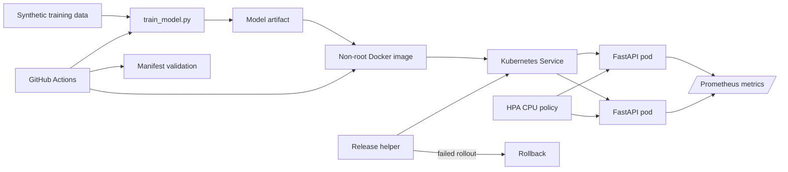

# MLOps Kubernetes Stack

A runnable reference project for the **model build → container → Kubernetes rollout → autoscaling → observability → rollback** lifecycle.

The model is intentionally tiny and synthetic. The point of the repository is the operational path around it.

## Architecture



## What is implemented

- deterministic scikit-learn training artifact;
- FastAPI prediction service;
- separate liveness, readiness and startup probes;
- Prometheus counters, histogram latency and model-readiness gauge;
- non-root Docker image;
- Kubernetes Deployment + ClusterIP Service + HPA;
- zero-unavailable rolling-update strategy;
- CPU requests/limits and scale-up/scale-down stabilization policies;
- PodDisruptionBudget;
- ingress/egress NetworkPolicy;
- dropped Linux capabilities, read-only root filesystem and seccomp runtime-default;
- pre-stop delay and termination grace period for draining;
- rollout helper with automatic rollback when deployment status fails;
- CI that runs tests, Ruff, manifest checks, Docker build and container health/metrics smoke tests.

## Local run

```bash
pip install -r requirements.txt
python train_model.py
uvicorn app:app --reload
```

```bash
curl http://localhost:8000/health/live
curl http://localhost:8000/health/ready
curl http://localhost:8000/metrics
curl -X POST http://localhost:8000/predict \
  -H "Content-Type: application/json" \
  -d '{"features":[0.2,0.4,0.8,0.1]}'
```

## Build the container

```bash
docker build -t ml-model-service:local .
docker run --rm -p 8000:8000 ml-model-service:local
```

The image trains the public demo artifact at build time and then runs as UID `10001`.

## Kubernetes

```bash
kubectl apply -f k8s/deployment.yaml
kubectl apply -f k8s/resilience.yaml
```

The service starts with two replicas. HPA can scale to eight replicas based on CPU utilization. Scale-down is intentionally slower than scale-up to reduce oscillation.

### Release and rollback

Use immutable tags or image digests in a real deployment:

```bash
python scripts/release.py deploy \
  --image ghcr.io/cagataykavas/mlops-kubernetes-stack@sha256:<digest> \
  --namespace ml
```

If `kubectl rollout status` fails, the helper requests `kubectl rollout undo` and waits for the previous revision to become healthy.

Manual rollback is also available:

```bash
python scripts/release.py rollback --namespace ml
```

## Health semantics

`/health/live` only answers whether the process is alive. `/health/ready` additionally requires the model artifact to be loaded. Kubernetes therefore stops routing traffic to an unready model without necessarily restarting a healthy process.

## Inference output contract

Before model execution, `/predict` requires exactly four JSON numbers. Boolean,
string, null, NaN, infinity, extra-field, and wrong-length inputs are rejected,
as are values outside the demo model's prespecified standardized range `[-8, 8]`.
Invalid requests return a stable HTTP `422` response without reflecting submitted
values and increment `ml_prediction_request_rejections_total`; they do not execute
the model or contaminate inference success, failure, or latency metrics.

`/predict` admits only binary classifiers whose `classes_` contains the integer
labels `0` and `1`. The positive-class column is resolved by label, so reversed
class ordering cannot silently invert the prediction. `predict_proba` must return
one numeric row of two finite probabilities in `[0, 1]`, summing to one within
an absolute tolerance of `1e-6` (no relative tolerance).

Model exceptions and invalid outputs return HTTP `503` with the stable message
`model inference unavailable`; raw model exception text is not sent to clients.
Rejected attempts increment `ml_prediction_failures_total`, do not increment the
success counter, and still contribute to inference latency. Missing artifacts
return `503` before inference and are represented by readiness, not this counter.
An invalid output does not unload the model or change readiness: readiness still
means artifact-loaded, not model-quality-approved.

This boundary validates request and response integrity, not calibration,
predictive quality, artifact provenance, semantic feature meaning, distribution
shift, or inference time/resource limits. The `[-8, 8]` policy is appropriate only
for this synthetic standardized model and must be replaced with versioned,
training-derived feature contracts in a real service. Only load trusted joblib
artifacts; these checks do not make deserialization safe.

Validate locally with `python -m pytest -q` and `ruff check .`. API tests include
malformed model outputs, reversed class ordering, exception redaction, metric
accounting, and inference with the actual deterministic training artifact.

## Observability

`/metrics` is Prometheus text format and exposes:

- `ml_predictions_total{predicted_class,model_version}`;
- `ml_prediction_failures_total` for model errors and rejected outputs;
- `ml_prediction_request_rejections_total` for pre-inference input rejection;
- `ml_prediction_latency_seconds` histogram;
- `ml_model_ready` gauge.

This gives the repository enough structure to discuss request rate, latency distributions, rollout comparison by model version and readiness alarms.

## Reliability and security choices

- `maxUnavailable: 0` keeps capacity during rolling updates.
- PDB protects voluntary disruptions from taking every replica down.
- startup/readiness/liveness probes have different responsibilities.
- pre-stop + termination grace time provide a simple connection-draining window.
- NetworkPolicy narrows traffic instead of leaving every pod implicitly reachable.
- the container is non-root, cannot escalate privileges, drops capabilities and uses a read-only root filesystem.

## Interview topics

This project is designed to support concrete discussion of:

**Docker layers · Kubernetes Deployment/Service · probes · HPA · requests vs limits · rolling updates · rollback · PDB · NetworkPolicy · Prometheus · immutable image tags · CI/CD · graceful termination · readiness vs liveness.**
